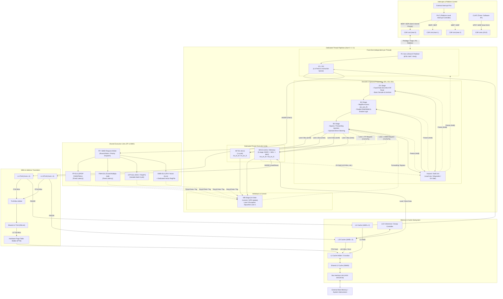

Sukuna-RISC
===========

`Sukuna-RISC` is a zlib-licensed RTL for a high-frequency 64-bit
RISC-V processor core implemented in Verilog 2025.

This project is a part of [zedBSD](https://github.com/awemorris/zedBSD)
and the CPU is intended for use with zedBSD.

The name Sukuna comes from Sukunahikona, literally meaning "Small
Genius," with a double meaning of "reduced" of RISC.

---

## 1. Architectural Overview

Sukuna-RISC is an in-order, 3-SMT (Simultaneous Multi-Threading),
asymmetric dual-issue processor implementing the 64-bit RISC-V RV64G
instruction set.

```
       +--------------------------------------------------------------------------+
       |                           Sukuna-RISC Core                               |
       |                                                                          |
       |  +--------------------+  +--------------------+  +--------------------+  |
       |  |       Hart 0       |  |      Hart 1        |  |       Hart 2       |  |
       |  |  7-Stage Pipeline  |  |  7-Stage Pipeline  |  |  7-Stage Pipeline  |  |
       |  +---------+----------+  +---------+----------+  +------+-------------+  |
       |            |                       |                    |                |
       |            +-----------------------+--------------------+                |
       |                                    |                                     |
       |            +-----------------------v--------------------+                |
       |            |    Shared Execution Units (FMA / CFP / V)  |                |
       |            +--------------------------------------------+                |
       |                                                                          |
       |  +--------------------+  +--------------------+  +--------------------+  |
       |  | L1I Cache 16KB x 3 |  | L1D Cache 16KB x 3 |  |     L2 TLB / PTW   |  |
       |  +---------+----------+  +---------+----------+  +------+-------------+  |
       |            +-----------------------+--------------------+                |
       |                                    v                                     |
       |            +--------------------------------------------+                |
       |            |         Shared 256KB L2 Cache (8-Way)      |                |
       |            +-----------------------+--------------------+                |
       +------------------------------------|-------------------------------------+
                                            v
                               AXI4 64/128-bit System Bus
```

### Key Parameters & Specifications

- **ISA**: RISC-V RV64G (`RV64IMAFD` + `Zicsr` + `Zifencei`), pure 32-bit fixed-length instructions (no RVC).
- **Harts (Hardware Threads)**: 3-way SMT (1 Core / 3 Threads):
  - **Hart 0 (T1: Kernel)**: OS kernel execution, driver management, and platform external interrupt handling.
  - **Hart 1 (T2: Foreground)**: High-priority interactive application main thread.
  - **Hart 2 (T3: Background)**: Background services, batch workers, and auxiliary threads.
- **Pipeline Depth**: 7-stage in-order pipeline per thread:
  `IF1 -> IF2 -> ID1 -> ID2 -> ID3 -> EX -> WB`
- **Issue Mechanism**: Fixed-lane asymmetric dual-issue with execution unit enable steering:
  - **Lane 0 (Older)**: Carries the older instruction in program order (`inst0`).
  - **Lane 1 (Younger)**: Carries the younger instruction in program order (`inst1`).
  - **EX Enable Steering**: Execution units (INT-EU, MA-EU) accept inputs from both lanes without datapath swap multiplexers.
  - **Dual-Issue Pairs**: `INT + MA` or `MA + INT` (when no RAW/WAW hazard exists and MA-EU is not stalled).
- **Cache Hierarchy**:
  - Parameterized N-way set-associative (2 <= N <= 32).
  - **L1 Instruction Cache (L1I)**: 48 KB total (16 KB dedicated per thread, default 4-way set-associative).
  - **L1 Data Cache (L1D)**: 48 KB total (16 KB dedicated per thread, default 4-way set-associative, byte-write strobe enabled).
  - **Shared L2 Cache**: 256 KB unified (shared across all threads, default 8-way set-associative).
  - **Physical Address Width (`PADDR_WIDTH`)**: Configurable 32-bit to 40-bit. Dynamic tag width calculation (`TAG_WIDTH = PADDR_WIDTH - INDEX_BITS - 6`).
  - **Word-Aligned Interconnect**: Dropping lower 2 bits (`[PADDR_WIDTH-1:2]`) across internal bus and memory interfaces.
- **Memory Management Unit (MMU)**:
  - **L1-ITLB**: 8 entries dedicated per thread, 1-cycle latency.
  - **L1-DTLB**: 8 entries dedicated per thread, 1-cycle latency.
  - **Shared L2-TLB**: 256 entries unified.
  - **Hardware Page Table Walker (PTW)**: Sv39 hardware page table walker.
- **Target Performance & Operating Frequencies**:
  - **5nm ASIC**: 1.5 GHz - 1.7 GHz (Tclk = 667 ps).
  - **AMD/Xilinx Kintex-7 FPGA (-2)**: > 200 MHz sustained (204.12 MHz achieved on KC705).
  - **Resource Footprint (KC705)**: 105.9k LUTs, 47.8k FFs, 4 BRAM tiles, 48 DSP slices (core level).

---

## 2. Architectural Decision: Eliminating RVC

Instruction compression (RVC: 16-bit compressed instructions) is inherently a trade-off technique designed to maximize instruction cache hit rates in environments where memory hierarchy bandwidth is severely constrained.

In a high-frequency processor with well-provisioned L1/L2 caches and wide interconnect bandwidth, adopting RVC introduces disproportionate hardware penalties:

1. **Variable-Length Boundary Detection**: Dynamically identifying variable 16-bit vs. 32-bit instruction boundaries at arbitrary 2-byte granularities creates deep logic chains.
2. **Cross-Boundary Instruction Reassembly**: Multi-entry fetch buffers are required to reconstruct instructions that straddle 64-bit cache line boundaries.
3. **Dynamic Shifting & Speculative Decompression for Dual-Issue**: The starting byte position of the second instruction dynamically depends on the length of the first instruction, requiring parallel speculative decompression trees (C2 vs. C4 candidates) and wide multiplexing trees.
4. **Misaligned Instruction Exceptions**: Complex handling for non-4-byte-aligned branch targets and trap vectors.

These factors concentrate logic complexity and wiring congestion directly into the instruction fetch (IF) stages, becoming the primary bottleneck that degrades maximum operating frequency (Fmax).

By decisively committing to **RV64G (pure 32-bit fixed-length instructions) and eliminating RVC**:

- The fetch-to-decode structure is streamlined to zero-overhead logic.
- All instruction addresses and PC increments are strictly 4-byte (or 8-byte) aligned.
- Dual-issue slot extraction becomes trivial, fixed-wire slicing (`[31:0]` for Slot 0, `[63:32]` for Slot 1).
- All RVC decompressors, rotational shifters, and multi-cycle fetch alignment queues are eradicated, unlocking high operating frequency.

---

## 3. Thread Pipeline & Microarchitecture

To achieve 1.5 GHz on 5nm ASIC and > 200 MHz on 28nm FPGA, each hardware thread executes through a dedicated 7-stage in-order pipeline:

```
+-----+     +-----+     +-----+     +-----+     +-----+     +----+     +----+
| IF1 | --> | IF2 | --> | ID1 | --> | ID2 | --> | ID3 | --> | EX | --> | WB |
+-----+     +-----+     +-----+     +-----+     +-----+     +----+     +----+
   ^           ^           ^           ^           ^           |
   |           |           |           |           |           |
   +-----------+-----------+-----------+-----------+-----------+
                     EX Stall Backpressure
```

### 3.1 Fixed-Lane Architecture & EX Enable Steering

#### Total Elimination of Datapath Multiplexers
Conventional dual-issue designs assign dedicated functions to slots (e.g., Slot 0 = INT, Slot 1 = MA). When an `[MA, INT]` pair is fetched, hundreds of datapath wires (operands, immediates, register specifiers) must be swapped through wide multiplexers, degrading critical path timing.

Sukuna-RISC preserves physical instruction order straight through the pipeline:
- **Lane 0 (Older)**: Carries the older instruction (`inst0`) in program order through to Writeback.
- **Lane 1 (Younger)**: Carries the younger instruction (`inst1`) in program order through to Writeback.
- **EX Enable Steering**:
  - **INT-EU**: Accepts operand busses from both Lane 0 and Lane 1. Activated by `int_en_l0` or `int_en_l1`.
  - **MA-EU**: Accepts operand busses from both Lane 0 and Lane 1. Activated by `ma_en_l0` or `ma_en_l1`.
  - When issuing `[INT, MA]`: `int_en_l0 = 1`, `ma_en_l1 = 1`.
  - When issuing `[MA, INT]`: `ma_en_l0 = 1`, `int_en_l1 = 1`.

#### Natural Precise Exception Guarantee
Because Lane 0 is strictly older and Lane 1 is strictly younger:
- If the leading Lane 0 instruction triggers an exception (e.g., page fault on load/store), Lane 1 commit is squashed by trivial gating:
  `if (lane0_exception) commit_lane1 = 0;`
- No complex reorder buffers, speculative rename tables, or swap-tracking tags are required.

---

### 3.2 Pipeline Stage Responsibilities

#### ① IF1 (Instruction Fetch 1)
- **PC Generation**: Selects the next fetch PC among branch prediction targets, trap/exception vectors, or sequential increment (+4 / +8).
- **L1-ITLB & Cache Request**: Initiates 1-cycle L1-ITLB virtual-to-physical address translation and drives L1I cache tag and data arrays.

#### ② IF2 (Instruction Fetch 2)
- **Instruction Queue & Skid Buffer**: Receives raw 64-bit data from the L1I cache array into a low-latency instruction buffer.
- **Fixed Slicing**: Instantly slices the 64-bit word into `inst0 = rdata[31:0]` and `inst1 = rdata[63:32]`.

#### ③ ID1 (Instruction Decode 1) — Zero-MUX Register File Addressing
- **Fixed-Field Unconditional Register Fetch**:
  - In RISC-V, source register indices occupy fixed bit positions across all instruction formats:
    `rs1 = inst[19:15]`, `rs2 = inst[24:20]`
  - Instead of waiting for instruction decode, instruction bits are wired directly to the register file read address ports:
    - Port A / Port B: Lane 0 (`inst0[19:15]`, `inst0[24:20]`)
    - Port C / Port D: Lane 1 (`inst1[19:15]`, `inst1[24:20]`)
  - Eliminates address multiplexers, minimizing RAM setup time to the physical limit.
- **Basic Decode**: Identifies opcode classes (INT, MA, FP, SIMD, SYSTEM) and generates 64-bit immediates.

#### ④ ID2 (Instruction Decode 2) — Parallel Hazard Check & Issue Steering
- **Register Array Access**: Register file data is read out from flip-flop RAM (`sk_ram_ff`).
- **Concurrent Hazard & Issue Logic**: In parallel with RAM read-out, 5-bit comparators evaluate RAW and WAW dependencies between `inst0` and `inst1`:
  - `inst0 = INT, inst1 = MA`: Checked for RAW (`inst1.rs != inst0.rd`).
  - `inst0 = MA, inst1 = INT`: Checked for RAW (`inst1.rs != inst0.rd`) and WAW (`inst1.rd != inst0.rd`).
- **Suppression of MEM -> INT Dual-Issue**:
  - MA instructions require 3 cycles (ADDR -> MA1 -> MA2).
  - If a subsequent INT depends on the load result, co-issuing them would require selectively stalling only the INT-EU inside EX while routing a dedicated bypass from L1D output to ALU input.
  - To prevent routing congestion and timing failure at 1.5 GHz, **co-issue is strictly prohibited when younger INT depends on older MEM**. The INT instruction is held in ID2 with a half-width bubble injected on Lane 1, issuing normally on the subsequent cycle.

#### ⑤ ID3 (Instruction Decode 3) — Bypass Resolution & EX Direct Delivery
- **Forwarding Integration**: Injects latest bypass values from EX and WB stages.
- **Direct Arithmetic Routing**: Directs resolved operands straight to the execution unit inputs without intervening pre-ALU multiplexers.

#### ⑥ EX (Execution Stage)
- **INT-EU**: Single-cycle integer ALU (add, sub, logical, shifts, comparisons).
- **MA-EU**: Dedicated 3-stage memory pipeline:
  - **ADDR (Cycle 1)**: Computes 64-bit effective address (`base + offset`).
  - **MA1 (Cycle 2)**: Translates virtual address via L1-DTLB and issues request to L1D cache.
  - **MA2 (Cycle 3)**: Latches synchronous read response from L1D data RAM.
  - **Direct WB Connection**: L1D output routes directly to WB, where byte alignment and sign-extension occur without consuming additional EX execution cycles.
- **Shared Execution Units**: High-throughput execution for floating-point and vector math.

#### ⑦ WB (Writeback / Commit)
- **Dual-Lane In-Order Commit**: Retires Lane 0 and Lane 1 results simultaneously to architectural registers.
- **Precise Exception Handling**: Immediately suppresses Lane 1 retirement if Lane 0 encounters an exception.

---

### 3.3 Zero-MUX Even-Aligned Fetch & Non-Shifting Issue

At 1.5 GHz (Tclk = 667 ps), a single 2:1 multiplexer on a 32-bit bus incurs 30 to 50 ps of delay (5% to 8% of the clock cycle). Sukuna-RISC eliminates all datapath multiplexers in the front-end using **Write-Enable (WEN) freeze control**:

```
[ Cycle 1: Instruction AAA issues single; BBB held ]
  L1I Cache  ──(Even 8B Read: No Alignment MUX)──> [ AAA, BBB ]
  ID1 Stage  : Slot 0 = AAA (Issue), Slot 1 = BBB (NOP Issue & Reg Frozen)
  * wen_slot1 = 0 holds BBB in Slot 1 without shifting to Slot 0!

[ Cycle 2: Next Even 8B [CCC, DDD] fetched and received with direct wiring ]
  L1I Cache  ──(Next Even 8B Read)───────────────> [ CCC, DDD ]
  ID1 Stage  : Slot 0 = CCC (New capture: wen0=1), Slot 1 = BBB (Held: wen1=0)
  * Direct physical slot feed creates pair [CCC / BBB] without cross-wiring MUX!
```

#### Non-Shifting Issue & WEN Freeze
When `AAA` issues alone and `BBB` cannot co-issue:
- **Cycle 1**: `AAA` issues through Slot 0. Slot 1 emits a NOP bubble. `BBB` is held directly in Slot 1 by deasserting clock-enable (`wen_slot1 = 0`).
- **Cycle 2**: Next 8-byte word `[CCC, DDD]` is fetched. `CCC` enters Slot 0 (`wen_slot0 = 1`), while `BBB` remains stationary in Slot 1.
- The pair `[CCC, BBB]` is formed at ID1 **without passing through any cross-lane multiplexer**.

#### Age Detection & Inverted Issue (`slot1_is_older`)
When instructions are placed with younger `CCC` in Slot 0 and older `BBB` in Slot 1:
- `slot1_is_older` is asserted.
- Hazard detection reverses check direction: verifies if Slot 0 (`CCC`) reads Slot 1 (`BBB`) destination.
- If independent, they co-issue in parallel without physical swapping. If dependent, IF1/IF2 stalls 1 cycle while `BBB` issues first.

#### FMA Dual-Slot Occupancy
Fused Multiply-Add (`FMA`: `rs1 * rs2 +/- rs3`) requires three source operands. Rather than adding an expensive 3rd read port (3R1W) to the Floating-Point Register file (FPR), an FMA instruction **occupies both Slot 0 and Slot 1 simultaneously**:

```
Slot 0 (Lane 0): FMA Opcode ──> Reads rs1_0, rs2_0 (Supplies rs1, rs2)
Slot 1 (Lane 1): (Co-opted)  ──> Reads rs1_1       (Supplies rs3!)
* Lane 1 datapath and bypass wiring directly transport rs3 to the FMA unit!
```

- **FMA always issues as `FMA / NOP`**:
  - `INT / FMA`: Cannot co-issue (Slot 1 cannot fetch 3 operands); INT issues, FMA is held.
  - `FMA / xxx`: FMA captures Slot 1 register ports; `xxx` is automatically forced into a bubble.
- **Benefits**: Zero extra read ports on FPR (maintains standard 2R2W replication), zero additional 64-bit operand busses, and minimal control logic.

---

### 3.4 ASIC 1.5 GHz Timing Budget & Logic Distribution

To ensure timing closure at 1.5 GHz (Tclk = 667 ps), combinational logic depth between pipeline registers is capped at **2 to 3 complex gate levels** (6 to 8 inverter/NAND delays equivalent):

| Component | Budget Allocation | Description |
| :--- | :---: | :--- |
| **Clock & Flop Overhead** | ~200 ps | `Tcq + Tsetup + Clock Skew/Jitter + OCV Margin` |
| **Wire & Interconnect Margin** | ~200 ps | Global macro routing and intra-cell RC parasitic delay |
| **Net Combinational Budget** | ~250 ps | Usable logic delay (2 to 3 gate levels per stage) |

#### ID1 / ID2 / ID3 Stage Balancing
| Stage | Key Operations | Gate Levels | Design Optimization |
| :--- | :--- | :---: | :--- |
| **ID1** | Fixed-bit RegFile address drive, basic decode, immediate generation | 1–2 | Direct wire slicing to RAM `raddr` without decode delay (Zero-MUX). |
| **ID2** | 5-bit equality comparators for RAW/WAW, dual-issue check, EU enable drive | 2–3 | Hazard checks run completely in parallel with RegFile RAM array access. |
| **ID3** | 5-bit bypass comparators, 3:1 operand forwarding multiplexers | 2 | Forwarding resolves immediately prior to EX stage, feeding directly into ALUs. |
| **EX** | Dedicated arithmetic execution | Pipelined | Direct arrival into arithmetic arrays without front-end input multiplexers. |

#### Word-Addressed Busses & Byte-Write Strobes
- **Lower 2-Bit Truncation (`[PADDR_WIDTH-1:2]`)**: Because instruction and data accesses are naturally aligned to word boundaries, intra-core address busses (IF1, IF2, ITLB, DTLB, L1I, L1D, L2, BIU) truncate `addr[1:0]`, saving wiring congestion and reducing interconnect capacitance.
- **Dedicated Byte Strobes (`byte_en[7:0]`)**: AGU generates byte enables directly from access size and low-order address bits, driving BRAM `wstrb[7:0]` inputs without complex aligner multiplexers on the write datapath.

---

## 4. Pipeline Hazard, Stall & Bubble Classification

To maintain precise architectural state without performance penalties, pipeline flow is controlled via 6 formal stall/bubble patterns:

- **Stall (Freeze / Hold)**: Pipeline register clock enables are disabled (`clk_en = 0`). Current stage state and program counter are preserved.
- **Bubble (Invalidate)**: An invalid marker (`valid = 0` / NOP) is injected into downstream registers, advancing the pipeline cleanly.

```
                                [ Stall & Bubble Classifications ]
                                                │
    ┌───────────────────┬───────────────────────┼───────────────────────┬───────────────────┐
    ▼                   ▼                       ▼                       ▼                   ▼
[ Pattern 1 ]       [ Pattern 2 ]           [ Pattern 3 ]           [ Pattern 4 ]       [ Pattern 5 / 6 ]
EX Memory Stall     Load-Use Hazard         Half-Width Bubble       [MA, INT] Skew      Shared EU Busy /
(L1D Miss / Bus)    (1-Cycle Bubble)        (Lane 1 NOP)            Commit Wait Bubble  Branch Flush
```

### Pattern 1: Memory Stall at EX Stage (MA-EU L1D Cache Miss / Bus Wait)
- **Trigger**: MA-EU encounters an L1D cache miss, L2 refill wait, or TLB miss.
- **Action**: MA-EU asserts `ex_stall`.
  - **Upstream Freeze**: Holds all upstream stages (`ID3, ID2, ID1, IF2, IF1`) in the current thread.
  - **Downstream Drain**: WB completes previously retired instructions, then freezes.
  - Other SMT threads continue execution uninterrupted.

### Pattern 2: Load-Use Data Hazard (1-Cycle Bubble Insertion)
- **Trigger**: An instruction immediately following a load references the loaded destination register `rd`.
- **Action**: Because MA requires 2 cycles (ADDR -> MA/L1D read) before data can be forwarded:
  - `ID1` and `IF` stages are stalled for 1 cycle.
  - A **1-cycle bubble (`valid = 0`)** is injected into `ID2/ID3` -> `EX`.

### Pattern 3: Incompatible Pair or Intra-Pair RAW/WAW Hazard (Half-Width Bubble)
- **Trigger**: Non-dual-issuable pairs (`INT + INT`, `MA + MA`), intra-pair RAW/WAW hazards, or younger INT depending on older MEM.
- **Action**:
  - `inst0` issues alone on **Lane 0**.
  - **Lane 1 receives a bubble (`valid = 0`)**.
  - Fetch PC increments by +4, and `inst1` carries over to become `inst0` on the next cycle.

### Pattern 4: `[MA, INT]` Commit Skew Wait (Precise Exception Guarantee)
- **Trigger**: Independent `[MA, INT]` dual-issue pair (Lane 0 = MA [2 cycles], Lane 1 = INT [1 cycle]).
- **Action**:
  - While INT completes in 1 cycle, MA memory exceptions (e.g., page fault) are not known until cycle 2.
  - Lane 1 holds its completed result, **delaying WB commit by 1 cycle** until Lane 0 confirms no exception.
  - If Lane 0 faults, Lane 1 is squashed without altering architectural state.

### Pattern 5: Shared Execution Unit Busy Stall
- **Trigger**: Contention for shared FP/SIMD units or long-latency multi-cycle operations (e.g., `FDIV`, `FSQRT`).
- **Action**: The shared arbiter asserts thread-specific busy backpressure, stalling `ID1/ID2/ID3` until the execution unit becomes available.

### Pattern 6: Branch Misprediction or Trap Pipeline Flush
- **Trigger**: Branch mispredict detected in EX, or an exception/trap event occurs.
- **Action**:
  - Speculative in-flight instructions are purged.
  - **Synchronous flush (`valid = 0`)** clears `IF1, IF2, ID1, ID2, ID3, EX`.
  - Fetch resumes from the corrected branch target or trap vector (`mtvec` / `stvec`).

---

### 4.1 Asymmetric Dual-Issue & Lane Control Matrix

| Older Inst (`inst0`) | Younger Inst (`inst1`) | Condition for Dual-Issue | Lane 0 | Lane 1 | INT-EU Driver | MA-EU Driver | Instructions Retired |
| :--- | :--- | :--- | :---: | :---: | :---: | :---: | :---: |
| **INT** | **MA** | `inst1.rs != inst0.rd`, MA not stalled | `inst0` (INT) | `inst1` (MA) | `int_en_l0 = 1` | `ma_en_l1 = 1` | 2 |
| **MA** | **INT** | `inst1.rs != inst0.rd` (no RAW)<br>`inst1.rd != inst0.rd` (no WAW)<br>MA not stalled | `inst0` (MA) | `inst1` (INT) | `int_en_l1 = 1` | `ma_en_l0 = 1` | 2 |
| **INT** | **INT** | Incompatible pair | `inst0` (INT) | Bubble (`valid=0`) | `int_en_l0 = 1` | 0 | 1 |
| **MA** | **MA** | Incompatible pair | `inst0` (MA) | Bubble (`valid=0`) | 0 | `ma_en_l0 = 1` | 1 |
| **INT / MA** | **FP / SIMD** | Shared EU available | `inst0` | `inst1` (FP/SIMD) | `int/ma_en_l0` | Shared Enable | 2 |
| **Hazard** | **Hazard** | RAW/WAW conflict (esp. MEM -> INT) | `inst0` | Bubble (`valid=0`) | - | - | 1 |

---

## 5. Comprehensive System Architecture & Block Diagram



---

### 5.1 Key Interconnects & Control Signal Specifications

| Source Unit | Destination Unit | Signals / Busses | Type | Description |
| :--- | :--- | :--- | :---: | :--- |
| **PLIC / CLINT** | **CSR Unit (Hart 0..2)** | `irq_m_ext`, `irq_s_ext`, `irq_timer`, `irq_sw` | Control | Asynchronous interrupt request lines to each Hart |
| **CSR Unit** | **PC Gen / Hazard** | `trap_valid`, `trap_target_pc`, `mret_sret_pc` | Control | Trap handling / return PC redirect and pipeline flush |
| **MA Stage (EX)** | **Hazard Unit** | `ex_stall` (L1D miss, bus wait) | Control | Stalls upstream stages (`ID3, ID2, ID1, IF2, IF1`) |
| **Hazard Unit** | **IF / ID1 / ID2 / ID3** | `stall_fetch`, `stall_id1`, `stall_id2`, `stall_id3` | Control | Clock enable deassertion (pipeline register freeze) |
| **Hazard Unit** | **ID3 / EX** | `bubble_lane1`, `insert_load_use_bubble` | Control | Injects bubble (`valid = 0`) on single-issue or load-use hazard |
| **ID2 Stage** | **EX Stage (INT/MA)** | `int_en_l0/l1`, `ma_en_l0/l1` | Control | Steers lane inputs to execution units without datapath MUXes |
| **ID1 Stage** | **RegFile** | `raddr_inst0_rs1/rs2`, `raddr_inst1_rs1/rs2` | Address | Instruction bit-slice read addresses directly to RAM |
| **ID1 Stage** | **Shared Arbiter** | `req_valid`, `hart_id[1:0]`, `op_type`, `operands` | Data/Ctrl | Requests allocation of shared FP/SIMD execution units |
| **Shared Arbiter** | **Hazard Unit** | `unit_busy`, `stall_thread[2:0]` | Control | Stalls issue of requesting thread when shared unit is busy |
| **Shared Units** | **WB Stage** | `resp_valid`, `hart_id[1:0]`, `dest_reg`, `res_data` | Data/Ctrl | Returns multi-cycle execution results to thread writeback |
| **MA Stage (AGU)** | **L1-DTLB / L1D** | `req_valid`, `vaddr[63:0]`, `wdata[63:0]`, `byte_en`| Data/Ctrl | Memory load and store requests |
| **L1D Cache** | **Coherence Unit** | `snoop_req`, `snoop_resp`, `invalidate_line` | Control | Inter-thread cache coherence maintenance |
| **TLB / PTW** | **L2 Cache Arbiter** | `ptw_req_addr`, `ptw_data_resp` | Data/Ctrl | Page Table Entry (PTE) refill transactions |
| **L1I / L1D** | **L2 Cache Arbiter** | `l2_req_valid`, `l2_req_type`, `line_addr`, `wline` | Data/Ctrl | 64-byte cache line refill and dirty eviction transactions |

---

## 6. Privileged Architecture & CSR Specification

Sukuna-RISC complies with the RISC-V Privileged Architecture Specification (v1.12), implementing Machine (M), Supervisor (S), and User (U) privilege modes to support full UNIX-like operating systems (Linux, FreeBSD) and real-time kernels.

### 6.1 Privilege Modes & State Transitions

```
       +---------------------------------------------+
       |                  M-Mode                     |
       |  (mtvec, mepc, mcause, mtval, mstatus)      |
       +---------------------------------------------+
             | MRET                  ^ Traps / ECALL
             v (Restore MPP/MPIE)    | (M-delegated = 0)
       +---------------------------------------------+
       |                  S-Mode                     |
       |  (stvec, sepc, scause, stval, sstatus, satp)|
       +---------------------------------------------+
             | SRET                  ^ Traps / ECALL
             v (Restore SPP/SPIE)    | (M-delegated = 1)
       +---------------------------------------------+
       |                  U-Mode                     |
       |             (User Programs)                 |
       +---------------------------------------------+
```

- **Machine Mode (`priv_mode = 2'b11`)**: Highest privilege level. Reset entry point. Full access to physical memory and hardware configuration CSRs.
- **Supervisor Mode (`priv_mode = 2'b01`)**: OS kernel execution mode. Supports Sv39 virtual memory address translation and S-mode interrupt/exception handling.
- **User Mode (`priv_mode = 2'b00`)**: Unprivileged user application mode. Traps to S-mode or M-mode upon attempting privileged instructions.

---

### 6.2 CSR Register Map

Each hardware thread implements an independent `sukuna_csr_unit`:

| Address | Name | Privilege | Description |
| :--- | :--- | :---: | :--- |
| `0x300` | `mstatus` | M (RW) | Machine status register (MIE, MPIE, MPP, FS, SUM, MXR, TVM, TW, TSR) |
| `0x301` | `misa` | M (RO) | ISA features implemented (`RV64IMAFDSU`, value: `64'h80000000_00141129`) |
| `0x302` | `medeleg` | M (RW) | Machine exception delegation register |
| `0x303` | `mideleg` | M (RW) | Machine interrupt delegation register |
| `0x304` | `mie` | M (RW) | Machine interrupt enable register (MEIE, MTIE, MSIE) |
| `0x305` | `mtvec` | M (RW) | Machine trap-handler base address (Direct / Vectored) |
| `0x340` | `mscratch`| M (RW) | Scratch register for machine trap handlers |
| `0x341` | `mepc` | M (RW) | Machine exception program counter |
| `0x342` | `mcause` | M (RW) | Machine trap cause code (MSB = Interrupt flag, `[4:0]` = Cause) |
| `0x343` | `mtval` | M (RW) | Machine bad address or instruction value |
| `0x344` | `mip` | M (RO/W) | Machine interrupt pending register |
| `0xF14` | `mhartid` | M (RO) | Hardware thread identifier (`0`, `1`, `2`) |
| `0x100` | `sstatus` | S (RW) | Supervisor status register (Restricted view of `mstatus`) |
| `0x104` | `sie` | S (RW) | Supervisor interrupt enable register (Delegated from `mideleg`) |
| `0x105` | `stvec` | S (RW) | Supervisor trap-handler base address |
| `0x140` | `sscratch`| S (RW) | Scratch register for supervisor trap handlers |
| `0x141` | `sepc` | S (RW) | Supervisor exception program counter |
| `0x142` | `scause` | S (RW) | Supervisor trap cause code |
| `0x143` | `stval` | S (RW) | Supervisor bad address or instruction value |
| `0x144` | `sip` | S (RW) | Supervisor interrupt pending register |
| `0x180` | `satp` | S (RW) | Supervisor address translation and protection (`MODE[63:60], ASID[59:44], PPN[43:0]`) |

---

### 6.3 Privileged & CSR Single-Issue Invariant

To guarantee architectural consistency, system instructions obey strict issue invariants:

1. **Strict Lane 0 Single-Issue**:
   - When `opcode == 7'b1110011` (`SYSTEM`: `CSRRx`, `ECALL`, `EBREAK`, `MRET`, `SRET`, `SFENCE.VMA`), `ID1` forces single-issue.
   - `ID2` suppresses `can_dual`, injecting a half-width bubble (`valid = 0`) into Lane 1.
   - Fetch consumes exactly 1 instruction (`consume_step = 1`), preserving the trailing instruction for next-cycle fetch into Lane 0.
2. **Commit-Stage Write Separation (Zero Speculative State Corruption)**:
   - **EX Stage**: Combinational read of CSR registers (`csr_raddr` -> `csr_rdata`) and privilege verification (`csr_illegal`).
   - **WB Stage**: Modifications to CSR state (`csr_commit_wen`) occur strictly upon commit when no preceding exception exists.

---

### 6.4 Traps, Returns & Virtual Memory Transitions

- **Trap Handling (`ECALL`, `EBREAK`, `PAGE_FAULT`, `ILLEGAL_INST`)**:
  - The WB stage asserts `trap_valid_o`, suppressing architectural register updates.
  - `u_csr` traps to M-mode or S-mode depending on `medeleg`/`mideleg`, saving `mepc`/`sepc` and `mcause`/`scause`.
  - Asserts `trap_flush_o`, flushing all in-flight pipeline stages (`IF1` to `EX`).
  - Fetches the next instruction directly from `mtvec` or `stvec`.
- **Privilege Return (`MRET`, `SRET`)**:
  - Emitted at WB stage, restoring privilege levels (`MPP`/`SPP`) and interrupt enables (`MPIE`/`SPIE`).
  - Purges pipeline and redirects PC to `mepc` or `sepc`.
- **Address Translation Switch (`satp` Update & `SFENCE.VMA`)**:
  - Updating `satp` or issuing `SFENCE.VMA` triggers a synchronous pipeline flush and flushes L1/L2 TLBs, ensuring subsequent fetches immediately utilize updated address mappings.

---

## 7. Synthesis & Timing Benchmark Results

The design has been verified and benchmarked under Out-Of-Context (OOC) logic synthesis using **AMD/Xilinx Vivado 2026.1** targeting the **Kintex-7 KC705** (`xc7k325tffg900-2`) evaluation board at a reference clock of **200.00 MHz (Tclk = 5.000 ns)**:

- **Top-Level SoC (`sukuna_top`)**: **204.12 MHz** (Slack: **+0.101 ns**, 195.6k LUTs, 65.0k FFs, 4 BRAMs, 48 DSPs) — **PASSED**
- **CPU Core (`sukuna_core`)**: **203.87 MHz** (Slack: **+0.095 ns**, 105.9k LUTs, 47.8k FFs, 4 BRAMs, 48 DSPs) — **PASSED**
- **Sequential Pipeline Modules**: **30 / 30 modules (100%) meet timing >= 200 MHz**.
- **Combinational Logic Blocks**: Evaluated under 5.0 ns virtual clocking; all critical paths exhibit propagation delays under 3.81 ns (equivalent to > 260 MHz), well within the 1-cycle timing envelope.

| Module | Category | Type | Fmax (MHz) | Data Path Delay (ns) | Slack (ns) | Slice LUTs | Slice FFs | Status |
| :--- | :--- | :---: | :---: | :---: | :---: | :---: | :---: | :---: |
| `sukuna_top` | Top SoC | Seq | **204.12** | 4.873 | +0.101 | 195,582 | 65,033 | ✅ PASS |
| `sukuna_core` | Top Core | Seq | **203.87** | 4.879 | +0.095 | 105,904 | 47,843 | ✅ PASS |
| `sukuna_biu_axi4` | Bus Interface | Seq | **571.43** | 1.489 | +3.250 | 356 | 1,750 | ✅ PASS |
| `sukuna_csr_unit` | Core Pipeline | Seq | **385.95** | 2.330 | +2.409 | 758 | 773 | ✅ PASS |
| `sukuna_int_eu` | Execution Unit | Seq | **355.87** | 2.824 | +2.190 | 2,040 | 650 | ✅ PASS |
| `sukuna_l1i_cache` | Cache Memory | Seq | **282.25** | 3.282 | +1.457 | 6,965 | 2,500 | ✅ PASS |
| `sukuna_l1d_cache` | Cache Memory | Seq | **261.37** | 3.565 | +1.174 | 13,767 | 3,269 | ✅ PASS |
| `sukuna_stage_ex` | Core Pipeline | Seq | **248.76** | 3.994 | +0.980 | 5,169 | 1,460 | ✅ PASS |
| `sukuna_agu_eu` | Execution Unit | Seq | **247.95** | 4.007 | +0.967 | 805 | 384 | ✅ PASS |
| `sukuna_l2_cache` | Cache Memory | Seq | **218.25** | 4.321 | +0.418 | 87,689 | 14,141 | ✅ PASS |
| `sukuna_thread_pipe`| Core Pipeline | Seq | **206.74** | 4.576 | +0.163 | 15,467 | 8,717 | ✅ PASS |
| `sukuna_stage_if2` | Core Pipeline | Seq | **203.83** | 4.880 | +0.094 | 1,498 | 456 | ✅ PASS |

---

## 8. Directory Structure

```
.
├── rtl/                        # Synthesizable Verilog RTL source code
│   ├── bus/                    # Bus Interface Unit (AXI4 BIU)
│   ├── cache/                  # L1I, L1D, and Shared L2 Cache subsystems
│   ├── core/                   # 7-stage pipelines, issue logic, execution units, CSRs
│   ├── include/                # Global architecture header files (sukuna_defines.vh)
│   ├── interrupt/              # Platform interrupt controllers (PLIC, CLINT)
│   ├── library/                # Arithmetic macros and technology-mapped RAM blocks
│   ├── mmu/                    # L1/L2 TLBs and hardware Page Table Walker (PTW)
│   ├── shared_ex/              # Multi-Hart shared FP and SIMD execution units
│   └── sukuna_top.v            # Top-level SoC integration
├── tb/                         # Simulation testbenches and ISA test suites
│   ├── isa/                    # RISC-V architectural compliance assembly tests
│   └── sukuna_tb.v             # Comprehensive verification testbench
├── scripts/                    # Synthesis, linting, and benchmark automation scripts
│   ├── asic-lint.py            # ASIC 1.5 GHz structural and timing rule checker
│   ├── run_isa_tests.py        # Automated ISA regression test runner
│   └── run_ooc_benchmark.py    # Out-Of-Context Vivado timing benchmark runner
├── style.md                    # Coding standard and ASIC 1.5 GHz design guidelines
└── README.md                   # Architecture specification (this document)
```

---

## 9. Verification & Build

Sukuna-RISC includes a self-checking testbench and runs automated RISC-V architectural compliance tests.

### Running Simulations

```bash
# Compile and run testbench with Icarus Verilog
make sim-run

# Run full ISA regression test suite (17 tests: rv64ui, rv64um, rv64ua, rv64uf, rv64ud, rv64priv)
python3 scripts/run_isa_tests.py
```

### Static Linting & ASIC Rules Checking

```bash
# Run RTL pre-checks and ASIC 1.5 GHz compliance linter
python3 scripts/asic-lint.py --all
```

---

## 10. License

Sukuna-RISC is released under the **Apache License 2.0**. See `LICENSE` for details.
