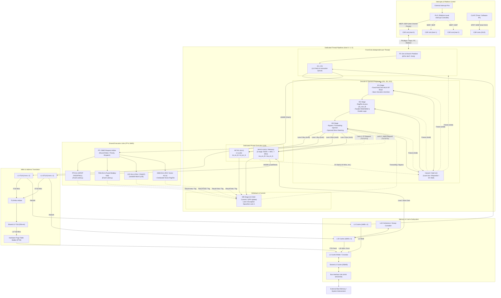

Sukuna RISC
===========

`Sukuna RISC` is a CPU for the
[zedBSD](https://github.com/awemorris/zedBSD)
project.  It is an area- and energy-efficient 64-bit RISC-V processor
core implemented in Verilog 2025.

The name Sukuna comes from Sukunahikona, literally meaning
"Small Genius," with a double meaning of "reduced" of RISC.

zedBSD achieves exceptional efficiency and responsiveness by
vertically optimizing the entire software stack from bottom to top,
including the kernel, direct GPU drivers, system services, Wayland
compositor, and desktop applications including a Web browser.  Because
this end-to-end integration completely eliminates software bloat, the
computational demands placed on the underlying hardware are
significantly lower.

Through close hardware/software co-design with the zedBSD system, this 
[Sukuna-RISC](https://github.com/awemorris/sukuna-risc)
and
[Amaterrace GPU](https://github.com/awemorris/amaterrace-gpu)
were conceived to deliver a first-class computing experience with low
power consumption, a tiny silicon die area, and low manufacturing
cost.  Rather than relying on brute-force power or chasing extreme
clock frequencies, it embodies a minimal, elegant architecture,
operating comfortably within conservative, nergy-efficient voltage and
clock envelopes while being tailored specifically to fulfill the
zedBSD user experience.

---

## 1. Project Background & Design Philosophy

### The zedBSD Ecosystem: End-to-End Vertical Co-Design

Modern generic processors have become monstrously bloated.  In order
to brute-force through unoptimized, fat software stacks (excessive
abstraction, bloated runtimes, inefficient IPC, and uncoordinated
scheduling), conventional CPUs dedicate huge amounts of silicon to
aggressive out-of-order execution windows, multi-level speculative
branches, register renaming tables, deep reorder buffers, and massive
caches. This brute-force approach demands exorbitant die area, drives
up silicon cost, and burns excessive power.

**Sukuna RISC rejects this brute-force paradigm.**

This project is conceived and built as an indispensable part of
**zedBSD**. zedBSD is an end-to-end, vertically integrated operating
system and desktop environment optimized seamlessly from the ground
up:

- **Micro-optimized Unix Kernel**: Deterministic scheduler, zero-copy
    drivers, and lean kernel primitives.

- **Direct GPU & DRM Drivers**: Low-overhead display rendering without
    bloated userspace abstraction layers.

- **Lightweight System Services**: Clean, non-blocking asynchronous
    system services.

- **Native Wayland Compositor & GUI Framework**: Ultra-responsive
    graphical interface with zero redundant buffer copies.

Because the entire zedBSD software stack is vertically optimized from
bottom to top, the computational demands imposed on the underlying
hardware are drastically reduced. Software bloat is eliminated before
it ever reaches the silicon.

```
       +-------------------------------------------------------------+
       |               zedBSD Native Applications & GUI              |
       +-------------------------------------------------------------+
       |           Lightweight Services & Wayland Compositor         |
       +-------------------------------------------------------------+
       |        Optimized zedBSD Kernel & Hardware Direct Drivers    |
       +-------------------------------------------------------------+
                                      |
                     Hardware/Software Co-Design Boundary
                                      |
       +-------------------------------------------------------------+
       |        Sukuna-RISC: Minimalist, Co-Designed 3-SMT Core      |
       |  Hart 0: Kernel/Drivers | Hart 1: Foreground | Hart 2: Bkg  |
       |  In-order 9-stage, Fixed-lane dual-issue, Zero-MUX datapath |
       +-------------------------------------------------------------+
```

### First-Class Computing with Minimal Silicon & Low Power

Rather than purchasing an oversized, expensive off-the-shelf CPU that
spends most of its energy fighting software inefficiencies, **we
designed the CPU and GPU themselves in tandem with zedBSD**.

By co-designing the hardware and software:

1. **Low Power Consumption & Modest Operating Voltage**: By keeping
   logic gates to only 2–3 levels per stage and using an in-order
   pipeline, the core operates at comfortable, power-efficient supply
   voltages with negligible dynamic switching energy.

2. **Minimal Silicon Die Area & Low Cost**: The core achieves its
   throughput with approximately 30k–100k LUTs on FPGA (a tiny
   fraction of a square millimeter in standard CMOS ASIC), drastically
   cutting silicon manufacturing costs.

3. **Hardware-Guaranteed Responsiveness**: SMT hardware threads are
   directly mapped to operating system roles, eliminating
   context-switch jitter and scheduling overhead for interactive
   desktop tasks.

---

## 2. Hardware/Software Co-Designed Threading Strategy

Sukuna-RISC implements 1 Core / 3 Hardware Threads (3-way SMT)
customized specifically for zedBSD's execution architecture:

```
[ Hart 0 (Kernel) ]     --> Dedicated to Kernel, Drivers, Display Compositor & IRQs
                            (Zero scheduling jitter, instant interrupt handling)

[ Hart 1 (Foreground) ] --> Dedicated to Active Foreground GUI Application
                            (Zero preemption by background tasks, silky-smooth UI)

[ Hart 2 (Background) ] --> Dedicated to Background Daemons, Indexers & Batch Workers
                            (Isolated workload, cannot degrade UI or kernel latency)
```

- **Hart 0 (T1: Kernel & System)**: Handles OS kernel syscalls,
    hardware device drivers, Wayland/DRM display compositor events,
    and platform external interrupts. Because the OS kernel has its
    own dedicated hardware thread, external device events and display
    synchronization are handled immediately without disturbing user
    applications.

- **Hart 1 (T2: Foreground Interactive Task)**: Dedicated exclusively
    to the primary interactive thread of the foreground
    application. The user-facing app never suffers frame drops or
    stutter caused by background services or kernel preemption.

- **Hart 2 (T3: Background Services)**: Handles background system
    daemons, periodic worker threads, compiler jobs, and
    non-interactive tasks. Even under heavy background workload, the
    interactive experience on Hart 1 remains instantaneous.

Image and graphics processing are among the most computationally
intensive tasks a processor faces. While handling these workloads on a
GPU is significantly faster and far more energy-efficient, modern
generic systems often suffer from driver fragmentation and API
compatibility barriers—preventing workloads from being reliably
offloaded and forcing the CPU to fall back to costly software
rendering. Consequently, traditional generic CPUs are forced to bloat
their silicon footprint simply to brute-force these heavy graphical
loads.

By co-designing the CPU, GPU, and OS (zedBSD) as a unified, seamless
triad, we eliminate these compatibility barriers at the architectural
level. Heavy rendering tasks are deterministically offloaded to the
power-efficient GPU, allowing the CPU itself to remain exceptionally
lightweight, compact, and energy-efficient.

Furthermore, to maximize device responsiveness and deliver an
ultra-fast, stutter-free UI/UX, dedicated hardware threads are
allocated directly to system roles:

- Hart 0 handles the OS kernel, device drivers, display compositor
  events, and hardware interrupts with zero scheduling jitter.

- Hart 1 is dedicated exclusively to the active foreground
  application, ensuring silky-smooth interactivity free from
  background preemption.

Through this holistic, full-stack optimization, Sukuna-RISC achieves
first-class computing performance without the silicon bloat or power
penalties of conventional processors.

---

## 3. Minimalist Microarchitecture: Area & Power Optimization

Every microarchitectural decision in Sukuna-RISC is guided by
**minimizing area and switching energy while guaranteeing responsive
single-cycle throughput**.

### 3.1 Eliminating RVC: Area & Power Savings Over Variable Decompression

While the RISC-V Compressed extension (RVC, 16-bit instructions)
improves memory density on memory-starved microcontrollers, it imposes
severe silicon area and power penalties on a high-throughput core:

1. **Elimination of Speculative Decompression Trees**: Supporting
dual-issue with variable-length instructions requires parallel
speculative decompression trees (C2 vs. C4 candidates) and dynamic
crossbar multiplexers. Eliminating RVC cuts thousands of gates from
the front-end.

2. **Elimination of Cross-Boundary Reassembly Buffers**: Fixed 32-bit
   instructions never straddle 64-bit cache line boundaries at
   arbitrary 2-byte offsets. Multi-entry reassembly staging buffers
   are completely eradicated.

3. **Direct Fixed-Wire Slicing**: Fetching a 64-bit word from the L1I
   cache yields two instructions by trivial, zero-cost wire slicing:
   `inst0 = rdata[31:0]` and `inst1 = rdata[63:32]`.

4. **Energy Reduction**: Eliminating variable length instruction
   shifts removes wide multiplexing nets that switch on every single
   cycle, significantly lowering front-end dynamic power dissipation.

### 3.2 Zero-MUX Addressing & Write-Enable (WEN) Freeze

Multiplexers on 32-bit and 64-bit datapaths consume significant
dynamic power, increase wire routing congestion, and demand larger
silicon area. Sukuna-RISC uses **Write-Enable (WEN) gating and direct
bit-slicing** to replace multiplexer arrays:

- **Zero-MUX Register File Addressing (ID1)**: In RISC-V, register
  specifiers are located at fixed bit positions across all instruction
  formats: `rs1 = inst[19:15]`, `rs2 = inst[24:20]`.  Instead of
  waiting for instruction decoding and routing addresses through
  multiplexers, instruction bit slices are wired directly to the
  register file RAM read ports.

- **Non-Shifting Issue with WEN Freeze**: When an instruction pair
  `[AAA, BBB]` is fetched and `AAA` issues alone while `BBB` must be
  held (due to hazard or single-issue constraint):
  - Conventional cores shift `BBB` from Slot 1 into Slot 0 through a
    wide cross-lane multiplexer on the next cycle.
  - Sukuna-RISC simply deasserts `wen_slot1 = 0` (clock-gating the
    flip-flop), leaving `BBB` stationary in Slot 1.
  - On the next cycle, the next instruction `CCC` is fetched directly
    into Slot 0 (`wen_slot0 = 1`).
  - The pair `[CCC, BBB]` is processed with zero datapath shifting
    multiplexers, drastically reducing silicon footprint and switching
    power.

- **FMA Dual-Slot Occupancy (Zero Extra Register Ports)**: Fused
  Multiply-Add (`FMA`: `rs1 * rs2 +/- rs3`) requires 3 source
  operands. Standard designs add a costly third read port (3R1W) to
  the floating-point register file (FPR), bloating RAM cell area by
  40%–50%.  Sukuna-RISC instead issues FMA across both slots (`FMA /
  NOP`):
  - Slot 0 reads `rs1` and `rs2`.
  - Slot 1 register port and bypass wiring are co-opted to read and transport `rs3`.
  - The FPR remains a compact 2-read-port macro with zero area overhead.

### 3.3 Conservative Voltage, High Timing Margin (ASIC & FPGA)

Sukuna-RISC bounds combinational logic to **2 to 3 gate levels per
stage**.  Importantly, this low logic depth is **not intended to chase
extreme, hot gigahertz clock rates**. Rather, it provides immense
timing margin that enables:

- **Low-Voltage Operation (Under-Volting)**: The processor easily
    meets its operating targets at lower, energy-efficient supply
    voltages (Vdd), achieving exponential dynamic power savings (power
    proportional to V^2).

- **FPGA Synthesis without Routing Congestion**: On low-cost 28nm FPGA
    devices (e.g. Kintex-7 / Artix-7), the design easily closes timing
    at > 200 MHz without requiring aggressive floorplanning, high tool
    effort, or hot running silicon.

- **Deterministic 1-Cycle Latencies**: Simple, balanced stages prevent
    unexpected multi-cycle stalls, ensuring predictable, smooth
    desktop interactivity.

---

## 4. Key Specifications

| Parameter | Specification | Microarchitectural Detail |
| :--- | :--- | :--- |
| **Target OS** | **zedBSD** | End-to-end vertically co-designed hardware/software stack |
| **Architecture** | RISC-V RV64G | `RV64IMAFD` + `Zicsr` + `Zifencei`, pure 32-bit fixed-length |
| **Hardware Threads** | 3-way SMT (1 Core / 3 Harts) | Hart 0: Kernel/Drivers/Display, Hart 1: Foreground UI, Hart 2: Background |
| **Pipeline** |9-stage In-Order | `IF1 -> IF2 -> ID1 -> ID2 -> ID3 -> EX (INT 1-stage/MEM 3-stage/FP N-stage) -> WB` |
| **Issue Logic** | Asymmetric Dual-Issue | Fixed-lane (`Lane 0: Older`, `Lane 1: Younger`) with EX enable steering |
| **Co-Issue Pairs** | `INT + MA` / `MA + INT` | Supported when no RAW/WAW hazard and MA is not stalled |
| **L1 Instruction Cache** | 48 KB total (16 KB / thread) | Dedicated per thread, 4-way set-associative, word-addressed |
| **L1 Data Cache** | 48 KB total (16 KB / thread) | Dedicated per thread, 4-way set-associative, byte-write strobe enabled |
| **Shared L2 Cache** | 256 KB unified | Shared across 3 Harts, 8-way set-associative, write-back |
| **MMU** | Sv39 Virtual Memory | L1-ITLB (8 ent/thread), L1-DTLB (8 ent/thread), Shared L2-TLB (256 ent), Shared PTW |
| **Interconnect** | Word-Addressed AXI4 | `[PADDR_WIDTH-1:2]` word addressing, 64/128-bit system bus interface |
| **Privilege Modes** | M-Mode, S-Mode, U-Mode | Full RISC-V Privileged Spec v1.12 compliance |
| **FPGA Footprint** | 77.9k LUTs, 52.9k FFs, 272 BRAM Tiles, 78 DSPs | Measured on Kintex-7 KC705 (`sukuna_kc705_top`) with full SoC, 3-SMT, caches, MMU & FP |
| **FPGA Clock** | **> 200 MHz** sustained | **200.16 MHz** achieved on full KC705 SoC top-level (`WNS = +0.004 ns`, `0` failing endpoints) |
| **ASIC Potential** | 1.5 GHz - 1.7 GHz @ 5nm | 2–3 gate levels per stage; ideal for low-voltage, sub-watt operation |

---

## 5. Thread Pipeline & Microarchitecture

```
+-----+     +-----+     +-----+     +-----+     +-----+     +----+     +----+
| IF1 | --> | IF2 | --> | ID1 | --> | ID2 | --> | ID3 | --> | EX | --> | WB |
+-----+     +-----+     +-----+     +-----+     +-----+     +----+     +----+
   ^           ^           ^           ^           ^           |
   |           |           |           |           |           |
   +-----------+-----------+-----------+-----------+-----------+
                     EX Stall Backpressure
```

### 5.1 Fixed-Lane Architecture & EX Enable Steering

Conventional dual-issue designs assign dedicated functions to execution slots (e.g., Slot 0 = INT, Slot 1 = MA). When an `[MA, INT]` pair arrives, hundreds of datapath signals must be physically swapped through large multiplexers.

Sukuna-RISC preserves natural physical instruction order through dedicated lanes:

- **Lane 0 (Older)**: Carries the older instruction (`inst0`) in
    program order through to Writeback.
- **Lane 1 (Younger)**: Carries the younger instruction (`inst1`) in
    program order through to Writeback.
- **EX Enable Steering**:
  - **INT-EU**: Accepts operand busses from both Lane 0 and Lane 1. Driven by `int_en_l0` or `int_en_l1`.
  - **MA-EU**: Accepts operand busses from both Lane 0 and Lane 1. Driven by `ma_en_l0` or `ma_en_l1`.
  - Issuing `[INT, MA]`: `int_en_l0 = 1`, `ma_en_l1 = 1`.
  - Issuing `[MA, INT]`: `ma_en_l0 = 1`, `int_en_l1 = 1`.

#### Natural Precise Exception Guarantee

Because Lane 0 is strictly older and Lane 1 is strictly younger:

- If Lane 0 (e.g., MA load/store) triggers an exception (such as a
  page fault), Lane 1 commit is squashed by trivial gating: `if
  (lane0_exception) commit_lane1 = 0;`

- No speculative rename tables, history buffers, or reorder buffers are needed.

---

### 5.2 Pipeline Stage Responsibilities

#### ① IF1 (Instruction Fetch 1)
- **PC Generation**: Selects next PC from branch target, trap vector, or sequential increment (+4 / +8).
- **L1-ITLB & Cache Request**: 1-cycle L1-ITLB virtual-to-physical translation and initiates L1I cache array read.

#### ② IF2 (Instruction Fetch 2)
- **Instruction Queue & Buffer**: Latches raw 64-bit data from the L1I cache into a shallow instruction buffer.
- **Fixed Slicing**: Slices the word into `inst0 = rdata[31:0]` and `inst1 = rdata[63:32]`.

#### ③ ID1 (Instruction Decode 1) — Zero-MUX Register Fetch
- **Fixed-Field Unconditional Register Fetch**: Instruction bits directly drive register file read addresses (`inst[19:15]`, `inst[24:20]`).
- **Basic Decode**: Identifies opcode classes (INT, MA, FP, SIMD, SYSTEM) and expands 64-bit immediates.

#### ④ ID2 (Instruction Decode 2) — Parallel Hazard Check & Issue Steering
- **Register Array Read**: Register file data is read out from flip-flop RAM (`sk_ram_ff`).
- **Concurrent Hazard Logic**: In parallel with RAM read-out, 5-bit comparators check RAW and WAW dependencies between `inst0` and `inst1`.
- **Suppression of MEM -> INT Dual-Issue**:
  - MA memory access requires 3 cycles (ADDR -> MA1 -> MA2).
  - Co-issuing a dependent INT would require stalling only the INT-EU inside EX while routing a dedicated bypass from L1D output to ALU input.
  - To prevent routing congestion and timing pressure, **co-issue is prohibited when younger INT depends on older MEM**. The INT instruction is held in ID2 with a half-width bubble injected on Lane 1, issuing cleanly on the next cycle.

#### ⑤ ID3 (Instruction Decode 3) — Bypass Resolution & EX Direct Delivery
- **Forwarding Integration**: Injects latest bypass values from EX and WB stages.
- **Direct Arithmetic Routing**: Directs resolved operands straight to execution unit inputs without pre-ALU multiplexers.

#### ⑥ EX (Execution Stage)
- **INT-EU**: Single-cycle integer ALU (arithmetic, logical, shifts, comparisons).
- **MA-EU**: Dedicated 3-stage memory pipeline:
  - **ADDR (Cycle 1)**: Computes 64-bit effective address (`base + offset`).
  - **MA1 (Cycle 2)**: Translates virtual address via L1-DTLB and issues request to L1D cache.
  - **MA2 (Cycle 3)**: Latches synchronous read response from L1D data RAM.
  - **Direct WB Connection**: L1D output routes directly to WB, where byte alignment and sign-extension occur without consuming additional EX cycles.
- **Shared Execution Units**: High-throughput execution for floating-point and vector math.

#### ⑦ WB (Writeback / Commit)
- **Dual-Lane In-Order Commit**: Retires Lane 0 and Lane 1 results simultaneously to architectural registers.
- **Precise Exception Handling**: Immediately suppresses Lane 1 retirement if Lane 0 encounters an exception.

---

## 6. Pipeline Hazard, Stall & Bubble Classification

Pipeline flow is governed by 6 formal stall/bubble patterns to maintain exact architectural state without complex control logic:

- **Stall (Freeze / Hold)**: Pipeline register clock enables are disabled (`clk_en = 0`). Current stage state and PC are preserved.
- **Bubble (Invalidate)**: An invalid marker (`valid = 0` / NOP) is injected downstream, advancing the pipeline cleanly.

```
                                [ Stall & Bubble Classifications ]
                                                │
    ┌───────────────────┬───────────────────────┼───────────────────────┬───────────────────┐
    ▼                   ▼                       ▼                       ▼                   ▼
[ Pattern 1 ]       [ Pattern 2 ]           [ Pattern 3 ]           [ Pattern 4 ]       [ Pattern 5 / 6 ]
EX Memory Stall     Load-Use Hazard         Half-Width Bubble       [MA, INT] Skew      Shared EU Busy /
(L1D Miss / Bus)    (1-Cycle Bubble)        (Lane 1 NOP)            Commit Wait Bubble  Branch Flush
```

- **Pattern 1: Memory Stall at EX (L1D Cache Miss / Bus Wait)**: MA-EU asserts `ex_stall`, freezing upstream stages (`ID3, ID2, ID1, IF2, IF1`) in the current thread while WB drains completed instructions.
- **Pattern 2: Load-Use Data Hazard (1-Cycle Bubble Insertion)**: When an instruction directly depends on a preceding load, `ID1` and `IF` stall for 1 cycle while a single bubble (`valid = 0`) is injected into `ID2/ID3 -> EX`.
- **Pattern 3: Incompatible Pair or Intra-Pair RAW/WAW Hazard (Half-Width Bubble)**: Incompatible pairs (`INT + INT`, `MA + MA`) or dependent pairs issue `inst0` alone on Lane 0, injecting a bubble on Lane 1. PC advances by +4.
- **Pattern 4: `[MA, INT]` Commit Skew Wait (Precise Exception Guarantee)**: When issuing independent `[MA, INT]`, Lane 1 (INT, 1 cycle) holds its result for 1 cycle until Lane 0 (MA, 2 cycles) confirms no memory exception.
- **Pattern 5: Shared Execution Unit Busy Stall**: Stalls `ID1/ID2/ID3` when a shared FP/SIMD unit is occupied by another Hart or executing multi-cycle operations (`FDIV`, `FSQRT`).
- **Pattern 6: Branch Misprediction or Trap Pipeline Flush**: Flushes all speculative stages (`IF1` through `EX`) with `valid = 0` and redirects fetch to corrected target or trap vector (`mtvec` / `stvec`).

### Dual-Issue & Lane Control Matrix

| Older Inst (`inst0`) | Younger Inst (`inst1`) | Condition for Dual-Issue | Lane 0 | Lane 1 | INT-EU Driver | MA-EU Driver | Instructions Retired |
| :--- | :--- | :--- | :---: | :---: | :---: | :---: | :---: |
| **INT** | **MA** | `inst1.rs != inst0.rd`, MA not stalled | `inst0` (INT) | `inst1` (MA) | `int_en_l0 = 1` | `ma_en_l1 = 1` | 2 |
| **MA** | **INT** | `inst1.rs != inst0.rd` (no RAW)<br>`inst1.rd != inst0.rd` (no WAW)<br>MA not stalled | `inst0` (MA) | `inst1` (INT) | `int_en_l1 = 1` | `ma_en_l0 = 1` | 2 |
| **INT** | **INT** | Incompatible pair | `inst0` (INT) | Bubble (`valid=0`) | `int_en_l0 = 1` | 0 | 1 |
| **MA** | **MA** | Incompatible pair | `inst0` (MA) | Bubble (`valid=0`) | 0 | `ma_en_l0 = 1` | 1 |
| **INT / MA** | **FP / SIMD** | Shared EU available | `inst0` | `inst1` (FP/SIMD) | `int/ma_en_l0` | Shared Enable | 2 |
| **Hazard** | **Hazard** | RAW/WAW conflict (esp. MEM -> INT) | `inst0` | Bubble (`valid=0`) | - | - | 1 |

---

## 7. System Architecture & Block Diagram



---

## 8. Privileged Architecture & CSR Specification

Sukuna-RISC fully implements the RISC-V Privileged Architecture (v1.12), providing Machine (M), Supervisor (S), and User (U) privilege modes to run full zedBSD multi-user unix kernels:

```
       +---------------------------------------------+
       |                  M-Mode                     |
       |  (mtvec, mepc, mcause, mtval, mstatus)      |
       +---------------------------------------------+
             | MRET                  ^ Traps / ECALL
             v (Restore MPP/MPIE)    | (M-delegated = 0)
       +---------------------------------------------+
       |                  S-Mode (zedBSD Kernel)     |
       |  (stvec, sepc, scause, stval, sstatus, satp)|
       +---------------------------------------------+
             | SRET                  ^ Traps / ECALL
             v (Restore SPP/SPIE)    | (M-delegated = 1)
       +---------------------------------------------+
       |                  U-Mode (User Apps)         |
       |             (Wayland, GUI, Shell)           |
       +---------------------------------------------+
```

### 8.1 CSR Register Map

Each hardware thread implements an independent `sukuna_csr_unit`:

| Address | Name | Privilege | Description |
| :--- | :--- | :---: | :--- |
| `0x300` | `mstatus` | M (RW) | Machine status register (MIE, MPIE, MPP, FS, SUM, MXR, TVM, TW, TSR) |
| `0x301` | `misa` | M (RO) | ISA features implemented (`RV64IMAFDSU`, value: `64'h80000000_00141129`) |
| `0x302` | `medeleg` | M (RW) | Machine exception delegation register |
| `0x303` | `mideleg` | M (RW) | Machine interrupt delegation register |
| `0x304` | `mie` | M (RW) | Machine interrupt enable register (MEIE, MTIE, MSIE) |
| `0x305` | `mtvec` | M (RW) | Machine trap-handler base address (Direct / Vectored) |
| `0x340` | `mscratch`| M (RW) | Scratch register for machine trap handlers |
| `0x341` | `mepc` | M (RW) | Machine exception program counter |
| `0x342` | `mcause` | M (RW) | Machine trap cause code (MSB = Interrupt flag, `[4:0]` = Cause) |
| `0x343` | `mtval` | M (RW) | Machine bad address or instruction value |
| `0x344` | `mip` | M (RO/W) | Machine interrupt pending register |
| `0xF14` | `mhartid` | M (RO) | Hardware thread identifier (`0`, `1`, `2`) |
| `0x100` | `sstatus` | S (RW) | Supervisor status register (Restricted view of `mstatus`) |
| `0x104` | `sie` | S (RW) | Supervisor interrupt enable register (Delegated from `mideleg`) |
| `0x105` | `stvec` | S (RW) | Supervisor trap-handler base address |
| `0x140` | `sscratch`| S (RW) | Scratch register for supervisor trap handlers |
| `0x141` | `sepc` | S (RW) | Supervisor exception program counter |
| `0x142` | `scause` | S (RW) | Supervisor trap cause code |
| `0x143` | `stval` | S (RW) | Supervisor bad address or instruction value |
| `0x144` | `sip` | S (RW) | Supervisor interrupt pending register |
| `0x180` | `satp` | S (RW) | Supervisor address translation and protection (`MODE[63:60], ASID[59:44], PPN[43:0]`) |

### 8.2 System Instruction Invariants & State Protection

- **Strict Lane 0 Single-Issue**: System instructions (`SYSTEM`: `CSRRx`, `ECALL`, `EBREAK`, `MRET`, `SRET`, `SFENCE.VMA`) always force single-issue on Lane 0, injecting a bubble on Lane 1.
- **Commit-Stage Write Separation**: CSR register modifications occur strictly at the WB stage when preceding instructions have committed without exception, eliminating speculative state pollution.
- **Synchronous Traps & TLB Flushes**: Updating `satp` or issuing `SFENCE.VMA` automatically purges in-flight pipeline stages and flushes L1/L2 TLBs, ensuring immediate address translation consistency for zedBSD virtual memory management.

---

## 9. Implementation & Timing Benchmark Results

The design has been verified and benchmarked under full top-level and Out-Of-Context (OOC) logic synthesis using **AMD/Xilinx Vivado 2026.1** targeting the **Kintex-7 KC705** (`xc7k325tffg900-2`) FPGA board at a reference clock of **200.00 MHz (`Tclk = 5.000 ns`)**:

- **Full KC705 SoC Top-Level (`sukuna_kc705_top`)**: **200.16 MHz** (Setup WNS: **`+0.004 ns`**, TNS: **`0.000 ns`**, **`0` / 178,393 failing endpoints**, Data Path: `4.852 ns`) — **PASSED**
  - **Slice LUTs**: `77,951 / 203,800` (`38.25%` — `77,677` Logic LUTs, `274` Distributed RAM LUTs)
  - **Slice Registers**: `52,907 / 407,600` (`12.98%` — `0` latches)
  - **Block RAM Tiles**: `272 / 445` (`61.12%` — `256` `RAMB36E1`, `32` `RAMB18E1`)
  - **DSP48E1 Slices**: `78 / 840` (`9.29%`)
- **Cache Subsystem Modules (ASIC 5nm / 250 MHz Surrogate Linter @ `Tclk = 4.000 ns`, `0` Rule 1–5 Violations)**:
  - **L1D Coherence (`sukuna_l1d_coherence`)**: **765.7 MHz** (`WNS = +2.694 ns`) — **PASSED**
  - **L2 Arbiter (`sukuna_l2_arbiter`)**: **481.7 MHz** (`WNS = +1.924 ns`) — **PASSED**
  - **Shared L2 Cache (`sukuna_l2_cache`, 256 KB)**: **266.5 MHz** (`WNS = +0.248 ns`) — **PASSED**
  - **L1I Cache (`sukuna_l1i_cache`, 16 KB/thread)**: **255.2 MHz** (`WNS = +0.081 ns`) — **PASSED**
  - **L1D Cache (`sukuna_l1d_cache`, 16 KB/thread, Non-Blocking Write-Allocate)**: **254.1 MHz** (`WNS = +0.064 ns`) — **PASSED**

---

## 10. Directory Structure

```
.
├── rtl/                        # Synthesizable Verilog RTL source code
│   ├── bus/                    # Bus Interface Unit (AXI4 BIU)
│   ├── cache/                  # L1I, L1D, and Shared L2 Cache subsystems
│   ├── core/                   # 9-stage pipelines, issue logic, execution units, CSRs
│   ├── include/                # Global architecture header files (sukuna_defines.vh)
│   ├── interrupt/              # Platform interrupt controllers (PLIC, CLINT)
│   ├── library/                # Arithmetic macros and technology-mapped RAM blocks
│   ├── mmu/                    # L1/L2 TLBs and hardware Page Table Walker (PTW)
│   ├── shared_ex/              # Multi-Hart shared FP and SIMD execution units
│   └── sukuna_top.v            # Top-level SoC integration
├── tb/                         # Simulation testbenches and ISA test suites
│   ├── isa/                    # RISC-V architectural compliance assembly tests
│   └── sukuna_tb.v             # Comprehensive verification testbench
├── scripts/                    # Synthesis, linting, and benchmark automation scripts
│   ├── asic-lint.py            # ASIC structural and timing rule checker
│   ├── run_isa_tests.py        # Automated ISA regression test runner
│   └── run_ooc_benchmark.py    # Out-Of-Context Vivado timing benchmark runner
├── style.md                    # Coding standard and design guidelines
└── README.md                   # Architecture specification (this document)
```

---

## 11. Verification & Build

Sukuna-RISC includes a self-checking testbench and runs automated RISC-V architectural compliance tests.

### Running Simulations

```bash
# Compile and run testbench with Icarus Verilog
make sim-run

# Run full ISA regression test suite (17 tests: rv64ui, rv64um, rv64ua, rv64uf, rv64ud, rv64priv)
python3 scripts/run_isa_tests.py
```

### Static Linting

```bash
# Run RTL pre-checks and structural compliance linter
python3 scripts/asic-lint.py --all
```

---

## 12. License

Sukuna-RISC is released under the **Apache License 2.0**. See `LICENSE` for details.
