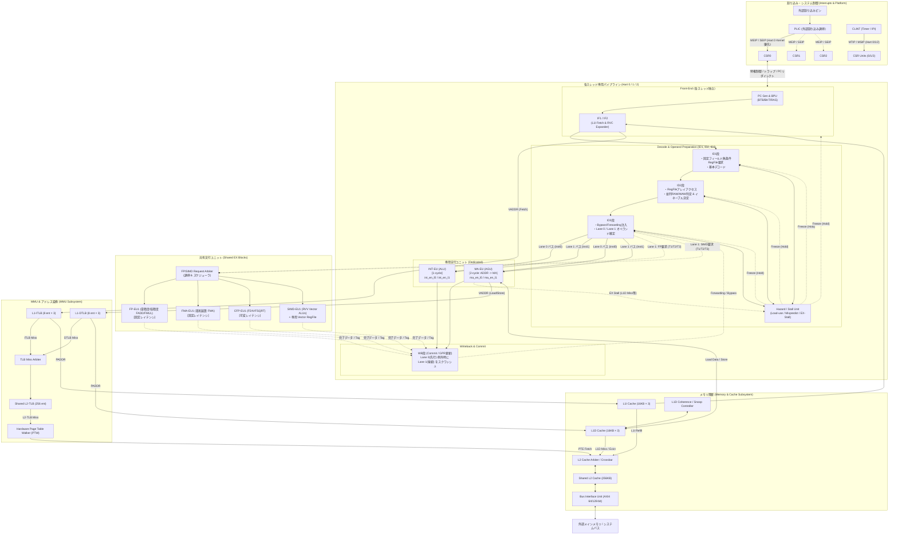

# Sukuna-RISC アーキテクチャ詳細設計書 (design.md)

本ドキュメントは、[README.md](file:///home/awe/sukuna-risc/README.md) で定義された基本コンセプト（RV64GC, 3-SMT, 非対称デュアルイシュー, L1/L2キャッシュ, MMU）に基づき、RTL実装に必要となる詳細ブロック、制御シグナル、データパス結線、パイプライン制御アルゴリズム、ストール・バブル挙動、およびシステム全体の統合ブロック図を定義します。

---

## 1. 全体アーキテクチャ概要

Sukuna-RISC は 1コア / 3スレッド（3-Hart: Hart 0=T1, Hart 1=T2, Hart 2=T3）構成のインオーダー 3-SMT プロセッサです。

### 主要パラメータ
- **ISA**: RISC-V RV64GC (RV64I, M, A, F, D, C, Zicsr, Zifencei)
- **Harts (Threads)**: 3 Harts
  - **Hart 0 (T1: Kernel)**: OSカーネル、ドライバ、外部割り込み処理
  - **Hart 1 (T2: Foreground)**: アプリケーションメインスレッド
  - **Hart 2 (T3: Background)**: バックグラウンドサービス、ワーカースレッド
- **パイプライン段数**: 7段インオーダー（各スレッド独立フロントエンド〜EX）
  - `IF1` $\to$ `IF2` $\to$ `ID1` $\to$ `ID2` $\to$ `ID3` $\to$ `EX` $\to$ `WB`
- **イシュー方式**: レーン固定型 非対称デュアルイシュー (In-order Dual-Lane with EX Enable Control)
  - **Lane 0**: 常にプログラム順序の先行命令 (`inst0`, Older)
  - **Lane 1**: 常にプログラム順序の後続命令 (`inst1`, Younger)
  - **EX内部イネーブル制御**: EXユニット（INT-EU, MA-EU）は両レーンから配線を受け、1-bit イネーブル信号で駆動（データパスのスワップ MUX を完全排除）
  - 同時発行ペア: `INT + MA` または `MA + INT`（依存関係・ハザードなし、MA-EU非ストール時）
- **キャッシュ階層**:
  - パラメータ化 N-way セットアソシアティブ ($2 \le N \le 32$)
  - L1I: 48KB (各スレッド専用 16KB × 3, デフォルト 4-way)
  - L1D: 48KB (各スレッド専用 16KB × 3, デフォルト 4-way, 8-bit バイトイネーブル対応)
  - L2: 256KB (共有, デフォルト 8-way)
  - 物理アドレス幅 (`PADDR_WIDTH`): `config.mk` で 32〜40 bit を設定可能。タグ幅は動的計算 ($\text{TAG\_WIDTH} = \text{PADDR\_WIDTH} - \text{INDEX\_BITS} - 6$)
  - モジュール間アドレス配線: 下位2ビット削り（`[PADDR_WIDTH-1:2]` ワードアドレス）の全面採用
- **MMU**:
  - L1-ITLB: 8エントリ (各スレッド専用, 1-cycle, ワードアドレス変換)
  - L1-DTLB: 8エントリ (各スレッド専用, 1-cycle, ワードアドレス変換)
  - Shared L2-TLB: 256エントリ (共有)
  - Shared PTW: ハードウェアページテーブルウォーカー (共有)

---

## 2. スレッドパイプライン詳細設計 (Pipeline Stages & Dual-Lane Control)

高周波動作（FPGA 500MHz / ASIC 1.5GHz）を達成するため、パイプラインは `IF1 -> IF2 -> ID1 -> ID2 -> ID3 -> EX -> WB` の7段構成とし、各段の責務を厳密に分離します。

```
+-----+     +-----+     +-----+     +-----+     +-----+     +----+     +----+
| IF1 | --> | IF2 | --> | ID1 | --> | ID2 | --> | ID3 | --> | EX | --> | WB |
+-----+     +-----+     +-----+     +-----+     +-----+     +----+     +----+
   ^           ^           ^           ^           ^           |
   |           |           |           |           |           |
   +-----------+-----------+-----------+-----------+-----------+
                     EX Stall Backpressure
```

### 2.1 レーン固定アーキテクチャ (In-Order Dual Lanes) と EX イネーブル制御

#### データパス MUX の完全排除
従来の「Slot 0=INT, Slot 1=MA」に物理データを流すアーキテクチャでは、`[MA, INT]` ペア実行時にオペランド・即値・レジスタ番号などの数百ビットを MUX で入れ替える（スワップする）必要があり、クリティカルパスの悪化を招いていました。

本設計では、**パイプライン自体を「Lane 0 (先行命令)」「Lane 1 (後続命令)」として直進固定**します：
- **Lane 0 (Older)**: プログラム順序の先行命令（`inst0`）のオペランド・制御信号を WB まで保持。
- **Lane 1 (Younger)**: プログラム順序の後続命令（`inst1`）のオペランド・制御信号を WB まで保持。
- **EX段のイネーブル制御**:
  - **INT-EU**: Lane 0 と Lane 1 の両方から入力を受領。`int_en_l0` または `int_en_l1` で駆動。
  - **MA-EU**: Lane 0 と Lane 1 の両方から入力を受領。`ma_en_l0` または `ma_en_l1` で駆動。
  - **`[INT, MA]` 発行時**: `int_en_l0 = 1`, `ma_en_l1 = 1`
  - **`[MA, INT]` 発行時**: `ma_en_l0 = 1`, `int_en_l1 = 1`

#### コミットと例外処理（Precise Exception）の自然な成立
Lane 0 が常に先行（Older）、Lane 1 が常に後続（Younger）に固定されているため：
- 先行する Lane 0（MA命令）がページフォルト等の例外を起こした場合、**単に「Lane 0 が例外なら Lane 1 のコミットを無効化する (`if (l0_exc) l1_commit = 0`)」という自明な論理**だけで正確な例外（Precise Exception）が成立します。スワップ追跡タグ等の引き回しは一切不要です。

---

### 2.2 各パイプライン段の責務

#### ① IF1 (Instruction Fetch 1)
- **PC Generation**: 分岐予測、例外/トラップリダイレクト、または通常インクリメント (+4 / +8) によるフェッチPC決定。
- **L1-ITLB & L1I Access**: L1-ITLB での仮想アドレス変換（1サイクル）と L1I キャッシュタグ/データアレイのアクセス開始。

#### ② IF2 (Instruction Fetch 2)
- **Fetch Buffer & RVC Expansion**: 
  - L1I から返された命令データ（64bitまたは32bit）を受信。
  - RV64C 圧縮命令（16bit）を 32bit 基本命令へインライン展開。
  - プログラム順序における先行命令 `inst0` と後続命令 `inst1` を抽出。

#### ③ ID1 (Instruction Decode 1) — 高速レジスタ要求 & 基本デコード
- **固定フィールドによる無条件レジスタフェッチ要求 (Zero-Mux RF Address)**:
  - RISC-V は命令フォーマットによらずレジスタ指定ビットが固定（`rs1`: `inst[19:15]`, `rs2`: `inst[24:20]`）。
  - **デコード完了を待たず、命令ビットをそのまま RegFile の読み出しポートへ直結**。
    - RegFile Port A/B: Lane 0 (`inst0`) のオペランドアドレス (`inst0[19:15]`, `inst0[24:20]`)
    - RegFile Port C/D: Lane 1 (`inst1`) のオペランドアドレス (`inst1[19:15]`, `inst1[24:20]`)
  - これにより、アドレス線にマルチプレクサを一切挟まず、RAMマクロのセットアップ時間を極小化。
- **基本デコード**:
  - `inst0`, `inst1` の命令種別（INT, MA, FP, SIMD）を判定。
  - 即値展開（Imm Gen）。

#### ④ ID2 (Instruction Decode 2) — 並列ハザード判定 & EUイネーブル決定
- **RegFile アレイアクセス**:
  - RegFile（`sk_ram_ff`）によるデータ読み出し中。
- **裏並列でのハザード & イネーブル判定**:
  - アレイアクセスと完全に並列して、2命令間のデータ依存関係（RAW/WAW）を判定：
    - `inst0 = INT, inst1 = MA`: `inst1.rs1 != inst0.rd` かつ `inst1.rs2 != inst0.rd`（RAWなし）
    - `inst0 = MA, inst1 = INT`: `inst1.rs1 != inst0.rd` かつ `inst1.rs2 != inst0.rd`（RAWなし）かつ `inst0.rd != inst1.rd`（WAWなし）
  - デュアルイシュー可否を判定し、`int_en_l0/1`, `ma_en_l0/1` を確定。

#### ⑤ ID3 (Instruction Decode 3) — バイパス解決 & EX直結
- **フォワーディング (Bypass) 注入**:
  - EX段およびWB段から戻る最新バイパスデータを適用。
- **EX段への直結供給**:
  - Lane 0 のオペランド群は INT-EU と MA-EU の Lane 0 入力ポートへ直結。
  - Lane 1 のオペランド群は INT-EU と MA-EU の Lane 1 入力ポートへ直結。
  - 確定したイネーブルビット（`int_en_l0/1`, `ma_en_l0/1`）を EX 段へ供給。

#### ⑥ EX (Execution)
- **INT-EU**: `int_en_l0` が有効なら Lane 0 を、`int_en_l1` が有効なら Lane 1 を演算（1-cycle）。
- **MA-EU**: `ma_en_l0` が有効なら Lane 0 を、`ma_en_l1` が有効なら Lane 1 を実行（2-cycle: ADDR $\to$ MA $\to$ L1D）。
- **Shared EX**: 共有 FP/SIMD ユニット実行。

#### ⑦ WB (Writeback / Commit)
- **In-Order Commit**:
  - Lane 0 の結果は Lane 0 コミットポートへ（プログラム先行命令）。
  - Lane 1 の結果は Lane 1 コミットポートへ（プログラム後続命令）。
- **Precise Exception 保証**:
  - 先行する Lane 0 が例外を起こした場合は、Lane 1 のコミットを強制無効化（スクワッシュ）。

---

### 2.3 ASIC 1.5GHz タイミングバジェットと論理配分

ASIC 1.5GHz 動作（クロック周期 $T_{\text{clk}} = 667\,\text{ps}$）におけるタイミング収束のため、FF間（ステージ間）の組合せ回路論理段数を最大 **2〜3論理段（複雑ゲート基準、インバータ/NAND換算で6〜8段）** に抑制する論理配分を採用しています。

#### ① タイミングバジェット内訳 ($T_{\text{clk}} = 667\,\text{ps}$)
- **FF・クロック起因オーバヘッド**: $T_{\text{cq}} + T_{\text{setup}} + \text{Clock Skew/Jitter} + \text{OCV Margin} \approx 200\,\text{ps}$
- **配線遅延マージン (Wire Delay)**: チップ内グローバル配線およびセル間配線 $\approx 200\,\text{ps}$
- **正味の組合せ論理遅延許容量**: $\approx 250\,\text{ps}$（各ステージ 2〜3 ゲート段数以内）

#### ② ID1 / ID2 / ID3 の精密バランシング
| ステージ | 主な処理内容 | ゲート遅延段数 | 設計上の最適化 |
| :--- | :--- | :--- | :--- |
| **ID1** | 固定ビット RegFile アドレス送出 + 命令種別判定 + 即値展開 | 1〜2段 | デコード結果を待たずに命令ビットを直接 RAM の `raddr` に直結 (Zero-Mux) |
| **ID2** | 5-bit 等価比較器による RAW/WAW 検出 + デュアルイシュー可否判定 + EX イネーブル決定 | 2〜3段 | RegFile RAM の内部アクセス時間と完全並列に依存関係チェックを実施 |
| **ID3** | 5-bit 等価比較器によるバイパス判定 + 3:1 オペランドバイパス MUX | 2段 | EX段の入力直前にバイパスを完了させ、EX段の演算器直結を実現 |
| **EX** | 演算器（ALU, AGU）による計算 | ユニット内パイプライン分割 | 入力前置 MUX なしで演算器アレイに直接データが到達 |

#### ③ アドレス下位2ビット削り (`[PADDR_WIDTH-1:2]`) とバイトイネーブル (`byte_en[7:0]`)
- **配線混雑度の低減**: 命令フェッチ（32/64-bit）およびデータアクセス（32/64-bit）は常にワード境界を基準とするため、モジュール間（IF1, IF2, ITLB, DTLB, L1I, L1D, L2, BIU）のアドレスバスから常に下位2ビット（`addr[1:0]`）を削減した `[PADDR_WIDTH-1:2]`（ワードアドレス）を採用。
- **バイト単位アクセスの抽象化**: L1D ではアドレス下位3ビットの代わりに `byte_en[7:0]` を AGU で生成し、BRAM マクロ（`sk_ram_bram`）のバイト書き込みストローブ `wstrb_i[7:0]` に直結。これにより、アドレス計算とバイト選択の論理を完全に分離し、クリティカルパスを大幅に短縮。

---

## 3. ストール・バブル挙動の全パターン分類

インオーダー・デュアルレーンパイプラインにおけるデータ整合性と正確な例外を保証するため、ストール（Hold / 時間停止）とバブル（Bubble / 無効化注入）の挙動を以下の6パターンに厳密分類・制御します。

### 3.1 ストールとバブルの基本動作
- **ストール (Freeze / Hold)**: パイプラインレジスタのクロックイネーブルを無効（`clk_en = 0`）にし、**現在の段のデータをそのまま保持**する。PC インクリメントも停止する。
- **バブル (Bubble / Invalidate)**: パイプライン段に `valid = 0`（無効フラグ / NOP）を注入し、**後続段を安全に空転**させる。

### 3.2 発生パターン詳細

```
                                [ ストール / バブル 発生パターン ]
                                               │
   ┌───────────────────┬───────────────────────┼───────────────────────┬───────────────────┐
   ▼                   ▼                       ▼                       ▼                   ▼
[ パターン 1 ]      [ パターン 2 ]          [ パターン 3 ]          [ パターン 4 ]      [ パターン 5 / 6 ]
EX メモリストール   Load-Use ハザード       単一イシュー片肺        [MA, INT] コミット  共有EUビジー /
(L1Dミス/バス待ち)  (1-bubble 挿入)         (Lane 1 バブル)         待機バブル          分岐ミス フラッシュ
```

#### パターン 1：EX段でのメモリストール (MA-EU L1Dキャッシュミス / バスウェイト)
- **原因**: MA-EU が L1D キャッシュミス、L2 リフィル待ち、または TLB ミスを起こした時。
- **制御挙動**:
  - MA-EU が `ex_stall` をアサート。
  - **上流全段ストール (Hold)**: 同一スレッド内の **`ID3, ID2, ID1, IF2, IF1` をすべてホールド（クロックイネーブル停止、PC更新停止）**。
  - **WB段**: すでに完了済みの命令は排出し、未完了のEX段が解決するまでパイプラインを完全凍結。
  - ※他スレッド（SMT）の独立パイプラインには一切波及しない。

#### パターン 2：ロード直後のデータ依存 (Load-Use Hazard) による 1サイクルバブル
- **原因**: MA（Load命令）の直後の命令が、ロードされたレジスタ `rd` を参照する場合（README: `1-bubble follows ld`）。
- **制御挙動**:
  - MA命令は 2サイクル（ADDR $\to$ MA/L1Dリード）かかるため、データがフォワーディング可能になるのは 2サイクル目の終わり。
  - **ID1/IF段**: 1サイクル間ストール（Hold）。
  - **EX段へ**: **1サイクルのバブル（`valid = 0`）を注入**して 1 サイクル待機。

#### パターン 3：非互換ペア・依存競合による「Lane 1 片肺バブル」(Half-Width Bubble)
- **原因**:
  - `INT + INT`, `MA + MA` など非対称構成で並列実行できないペアの場合。
  - 同一フェッチペア内の2命令間に RAW / WAW 競合がある場合（例: `ld x1` の直後に同一サイクルで `add x3, x1` がある場合）。
- **制御挙動**:
  - 先行命令 `inst0` のみ **Lane 0 で単独イシュー**。
  - **Lane 1 には「バブル（`valid = 0`）」を流す**。
  - フェッチ側は 1 命令分のみ PC を進め（`pc = pc + 4`）、後続命令 `inst1` は次サイクルの `inst0`（Lane 0）として持ち越す。

#### パターン 4：`[MA, INT]` 時のコミット順序調整バブル (Commit Wait / Skew Bubble)
- **原因**: 先行する Lane 0 が MA（2サイクル）、後続の Lane 1 が INT（1サイクル）のデュアルイシュー時。
- **制御挙動**:
  - 後続の INT は 1サイクルで EX 演算が完了するが、先行する MA のメモリアクセス例外（ページフォルト等）の有無は 2サイクル目まで確定しない。
  - **Precise Exception 保証**: Lane 1 (INT) は演算結果を保持したまま、**Lane 0 (MA) の例外チェックが通るまで WB コミットを 1 サイクル待機（コミットバブル）**させる。先行 MA が例外を起こした場合は Lane 1 を即座に無効化（スクワッシュ）。

#### パターン 5：共有 EX (FP / SIMD) のビジーストール
- **原因**: 他スレッドが共有 FP/SIMD ユニットを使用中、または CFP-EU1（除算 FDIV / 平方根 FSQRT 等の可変長多サイクル）が演算中の場合。
- **制御挙動**:
  - 共有アービターがビジーを通知。
  - 当該スレッドの **ID1/ID2/ID3 でイシュー保留ストール**をかけ、共有ユニットが空くまで待機（専用INT/MAには波及しない）。

#### パターン 6：分岐予測ミス / トラップによる「全段フラッシュ (Pipeline Clear)」
- **原因**: 分岐命令の予測失敗、または ECALL / 外部割り込みの発生。
- **制御挙動**:
  - 誤ってフェッチ・デコード中の後続命令をすべて破棄。
  - **`IF1, IF2, ID1, ID2, ID3, EX` の全パイプラインレジスタにバブル（`valid = 0` / 同期クリア）を一括注入**。
  - 正しい分岐先 PC またはトラップベクタ（`mtvec`）からフェッチを再開。

---

### 3.3 非対称デュアルイシュー & レーン制御マトリクス

| 先行命令 (inst0) | 後続命令 (inst1) | 成立条件 | Lane 0 (先行) | Lane 1 (後続) | INT-EU 駆動 | MA-EU 駆動 | 消費命令数 |
| :--- | :--- | :--- | :--- | :--- | :---: | :---: | :---: |
| **INT** | **MA** | `inst1.rs != inst0.rd`<br>MA-EU 非ストール | `inst0` (INT) | `inst1` (MA) | `int_en_l0 = 1` | `ma_en_l1 = 1` | 2命令 |
| **MA** | **INT** | `inst1.rs != inst0.rd` (RAWなし)<br>`inst1.rd != inst0.rd` (WAWなし)<br>MA-EU 非ストール | `inst0` (MA) | `inst1` (INT) | `int_en_l1 = 1` | `ma_en_l0 = 1` | 2命令 |
| **INT** | **INT** | - (単独イシュー) | `inst0` (INT) | バブル (`valid=0`) | `int_en_l0 = 1` | 0 | 1命令 |
| **MA** | **MA** | - (単独イシュー) | `inst0` (MA) | バブル (`valid=0`) | 0 | `ma_en_l0 = 1` | 1命令 |
| **INT / MA** | **FP / SIMD** | 共有ユニット利用可能時 | `inst0` | `inst1` (FP/SIMD) | `int/ma_en_l0` | 共有イネーブル | 2命令 |
| 依存あり | 依存あり | RAW / WAW 競合発生時 | `inst0` | バブル (`valid=0`) | - | - | 1命令 |

---

## 4. 全体ブロック図 (Comprehensive Block Diagram)

以下はプロセッサ全体の結線と制御・データフローを示すブロック図です。



---

## 5. 主要インタフェース & 制御バス仕様

| 送信元ユニット | 受信先ユニット | バス・信号群 | 種別 | 説明 |
| :--- | :--- | :--- | :--- | :--- |
| **PLIC / CLINT** | **CSR Unit (Hart 0..2)** | `irq_m_ext`, `irq_s_ext`, `irq_timer`, `irq_sw` | 制御 | 各Hartへの非同期割り込み要求線 |
| **CSR Unit** | **PC Gen / Hazard** | `trap_valid`, `trap_target_pc`, `mret_sret_pc` | 制御 | トラップ発生・復帰時のフェッチPC切り替え & パイプラインフラッシュ |
| **MA段 (EX)** | **Hazard Unit** | `ex_stall` (L1D miss, bus busy) | 制御 | **EX段からのストール通知。上流（ID3, ID2, ID1, IF2, IF1）をホールド** |
| **Hazard Unit** | **IF / ID1 / ID2 / ID3** | `stall_fetch`, `stall_id1`, `stall_id2`, `stall_id3` | 制御 | パイプラインレジスタのイネーブル停止（クロックホールド） |
| **Hazard Unit** | **ID3 / EX** | `bubble_lane1`, `insert_load_use_bubble` | 制御 | 単一イシュー時やロードユース時のバブル（valid=0）注入線 |
| **ID2段** | **EX段 (INT/MA)** | `int_en_l0/l1`, `ma_en_l0/l1` | 制御 | **EXユニットのレーン選択駆動イネーブル信号** |
| **ID1段** | **RegFile** | `raddr_inst0_rs1/rs2`, `raddr_inst1_rs1/rs2` | アドレス | **命令固定ビット直結（MUXなし）の読み出しアドレス** |
| **ID1段** | **Shared FP/SIMD Arbiter** | `req_valid`, `hart_id[1:0]`, `op_type`, `operands` | データ/制御 | FP/SIMDユニット利用要求とオペランド |
| **Shared FP/SIMD** | **Hazard Unit** | `unit_busy`, `stall_thread[2:0]` | 制御 | ユニットビジー通知による該当スレッドのイシューストール |
| **Shared FP/SIMD** | **WB段 (Commit)** | `resp_valid`, `hart_id[1:0]`, `dest_reg`, `res_data` | データ/制御 | 演算完了結果の各スレッドWriteback段への返却 |
| **MA段 (AGU)** | **L1-DTLB / L1D** | `req_valid`, `vaddr[63:0]`, `wdata[63:0]`, `mem_op` | データ/制御 | ロード・ストア要求 |
| **L1D Cache** | **Coherence Unit** | `snoop_req`, `snoop_resp`, `invalidate_line` | 制御 | スレッド間キャッシュ一貫性維持信号 |
| **TLB / PTW** | **L2 Cache Arbiter** | `ptw_req_addr`, `ptw_data_resp` | データ/制御 | ページテーブルエントリ（PTE）フェッチ要求 |
| **L1I / L1D** | **L2 Cache Arbiter** | `l2_req_valid`, `l2_req_type`, `line_addr`, `wline` | データ/制御 | キャッシュライン（64Byte）のリフィルおよびライトバック |

---

## 6. 実装フェーズとロードマップ

1. **フロントエンド & ID多段化 (Phase 1)**:
   - `ID1 -> ID2 -> ID3` 段レジスタの配備。
   - ID1での固定ビット RegFile 要求、ID2での並列ハザード検査と `int_en_l0/1`, `ma_en_l0/1` 生成、ID3でのフォワーディング結合。
2. **EXストールバックプレッシャー & バブル制御配線 (Phase 2)**:
   - パターン1〜6に基づく、MA-EU (L1Dミス) $\to$ Hazard Unit $\to$ ID3/ID2/ID1/IF2/IF1 のホールド制御線およびバブル注入線の完全結線。
3. **コミット & 例外順序調停 (Phase 3)**:
   - Lane 0 (先行 MA) 例外発生時の Lane 1 (後続 INT) 即座スクワッシュ機構の検証。
4. **共有ユニット調停 & MMU統合 (Phase 4)**:
   - FP/SIMD 調停器、L1/L2 TLB、およびハードウェアPTWの接続。
5. **コヒーレンシ & L2キャッシュ統合 (Phase 5)**:
   - 3スレッド間の一貫性制御と共有L2キャッシュの統合検証。

---

## 7. 特権アーキテクチャ & CSR詳細仕様 (Privileged Architecture & CSRs)

Sukuna-RISC は、UNIX系OS（Linux, FreeBSD）およびリアルタイムOSの実行を可能とするため、RISC-V Privileged Architecture v1.12 に準拠した Machine (M), Supervisor (S), User (U) の3つの特権モード、トラップ委譲機構、および仮想記憶制御レジスタを実装しています。

### 7.1 サポート特権モード & 状態遷移
- **Machine Mode (`priv_mode = 2'b11`)**: 最上位特権。リセット時の初期状態。全CSRへのフルアクセス権限。
- **Supervisor Mode (`priv_mode = 2'b01`)**: OSカーネル実行モード。仮想記憶（Sv39）管理、S-mode例外処理。
- **User Mode (`priv_mode = 2'b00`)**: ユーザアプリケーション実行モード。特権CSRアクセス禁止。

```
       +---------------------------------------------+
       |                  M-Mode                     |
       |  (mtvec, mepc, mcause, mtval, mstatus)      |
       +---------------------------------------------+
             | MRET                  ^ Traps / ECALL
             v (Restore MPP/MPIE)    | (M-delegated=0)
       +---------------------------------------------+
       |                  S-Mode                     |
       |  (stvec, sepc, scause, stval, sstatus, satp)|
       +---------------------------------------------+
             | SRET                  ^ Traps / ECALL
             v (Restore SPP/SPIE)    | (M-delegated=1)
       +---------------------------------------------+
       |                  U-Mode                     |
       |             (User Programs)                 |
       +---------------------------------------------+
```

### 7.2 CSR (Control and Status Register) レジスタマップ

各Hart（スレッドパイプライン）は独立した `sukuna_csr_unit` を保持します。

| アドレス | レジスタ名 | 権限 | 説明 |
| :--- | :--- | :--- | :--- |
| `0x300` | `mstatus` | M (RW) | マシンステータス (MIE, MPIE, MPP, FS, SUM, MXR, TVM, TW, TSR) |
| `0x301` | `misa` | M (RO) | アーキテクチャ構成 (`RV64IMAFDCSU`, 64'h80000000_0014112D) |
| `0x302` | `medeleg` | M (RW) | 例外委譲レジスタ (16-bit, S-modeへ委譲する例外ビット) |
| `0x303` | `mideleg` | M (RW) | 割り込み委譲レジスタ (16-bit, S-modeへ委譲する割り込みビット) |
| `0x304` | `mie` | M (RW) | マシン割り込みイネーブル (MEIE, MTIE, MSIE) |
| `0x305` | `mtvec` | M (RW) | マシントラップベクタ基底アドレス (Direct / Vectored) |
| `0x340` | `mscratch`| M (RW) | マシン作業用スクラッチレジスタ (64-bit) |
| `0x341` | `mepc` | M (RW) | マシン例外発生PC (トラップ時保存先) |
| `0x342` | `mcause` | M (RW) | マシントラップ原因コード (MSB=割り込みフラグ, [4:0]=Cause) |
| `0x343` | `mtval` | M (RW) | マシントラップ付加情報 (不正アドレス / 不正命令コード) |
| `0x344` | `mip` | M (RO/W) | マシン割り込み保留 (外部PLIC/CLINT入力およびソフトウェア割り込み) |
| `0xF14` | `mhartid` | M (RO) | ハードウェアスレッドID (`0`, `1`, `2`) |
| `0x100` | `sstatus` | S (RW) | `mstatus` のS-mode射影マスクビュー (`SIE, SPIE, SPP, FS, SUM, MXR`) |
| `0x104` | `sie` | S (RW) | `mideleg` で委譲されたS-mode割り込みイネーブル (`SEIE, STIE, SSIE`) |
| `0x105` | `stvec` | S (RW) | スーパーバイザトラップベクタ基底アドレス |
| `0x140` | `sscratch`| S (RW) | スーパーバイザ作業用スクラッチレジスタ (64-bit) |
| `0x141` | `sepc` | S (RW) | スーパーバイザ例外発生PC |
| `0x142` | `scause` | S (RW) | スーパーバイザトラップ原因コード |
| `0x143` | `stval` | S (RW) | スーパーバイザトラップ付加情報 |
| `0x144` | `sip` | S (RW) | スーパーバイザ割り込み保留 (`SEIP, STIP, SSIP`) |
| `0x180` | `satp` | S (RW) | ページテーブルルートアドレス & MMUモード (`MODE[63:60], ASID[59:44], PPN[43:0]`) |

### 7.3 レーン固定デュアルイシューにおける特権命令不変条件 (Single-Issue Invariant)

パイプライン内の特権状態の整合性を保証するため、特権命令およびCSR操作命令には厳格な単一発行規則を適用します：
1. **Lane 0 固定単一イシュー**:
   - `opcode == 7'b1110011` (SYSTEM) を検出した場合、ID1段において `id1_type0_o <= TYPE_NONE` を強制。
   - ID2段において `can_dual` 判定を抑制し、後続命令（Lane 1）にハーフ幅バブル (`id2_valid1_o = 0`) を注入。
   - フェッチ消費ステップを 1 (`consume_step = 1`) に制限し、次サイクルに後続命令を Lane 0 で再フェッチ。
2. **投機的CSR汚染の完全防止 (WB Commit Separation)**:
   - **EX段**: CSRレジスタのゼロ遅延組み合わせ読み出し（`csr_raddr_o` $\to$ `csr_rdata_i`）およびアクセス権限チェック（`csr_illegal_i`）。
   - **WB段**: 命令が先行例外なしで確定コミットした瞬間にのみ、CSRレジスタアレイへの書き込みコミット（`csr_commit_wen_o`）を実行。
   - これにより、EX段以前のストールや先行命令例外によるCSR破壊を完全に防止。

### 7.4 トラップ・リターン・仮想記憶切り替えフロー
- **例外発生 (`ECALL`, `EBREAK`, `PAGE_FAULT`, `ILLEGAL_INST`)**:
  - WB段でコミット時に `trap_valid_o = 1` を発行。
  - レジスタファイルへのコミット（Port 0/1/2）を即座に抑止。
  - `u_csr` が `mideleg`/`medeleg` に基づき M-Mode / S-Mode トラップ先を自動判定し、`mepc`/`sepc` と `mcause`/`scause` を保存。
  - `trap_flush_o = 1` を出力し、上流パイプライン段（`IF1`〜`EX`）をすべてフラッシュ。
  - `trap_target_pc_o` (`mtvec`/`stvec`) を IF1 段へ直結し、次サイクルからトラップハンドラを実行。
- **特権復帰 (`MRET`, `SRET`)**:
  - WB段で `mret_valid_o` / `sret_valid_o` を発行。
  - 特権レベルを `MPP` / `SPP` から復帰、割り込みイネーブルを `MPIE` / `SPIE` から復帰。
  - パイプラインをフラッシュし、フェッチPCを `mepc` / `sepc` にリダイレクト。
- **仮想記憶切り替え (`satp` 書換 / `SFENCE.VMA`)**:
  - WB段で `satp` の更新がコミットされた瞬間に `trap_flush_o` をアサートし、IF1のPCを `PC + 4` にリダイレクト。
  - MMUおよびTLBの古いアドレスマッピングによるパイプライン内の先行フェッチ命令を完全にパージ。

